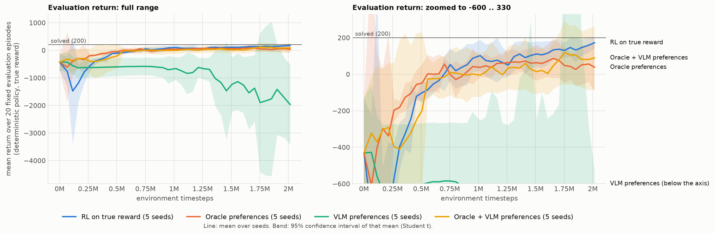
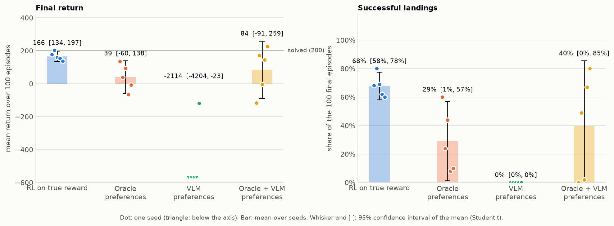
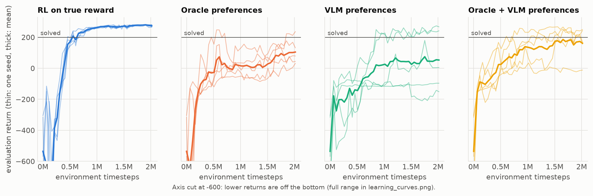
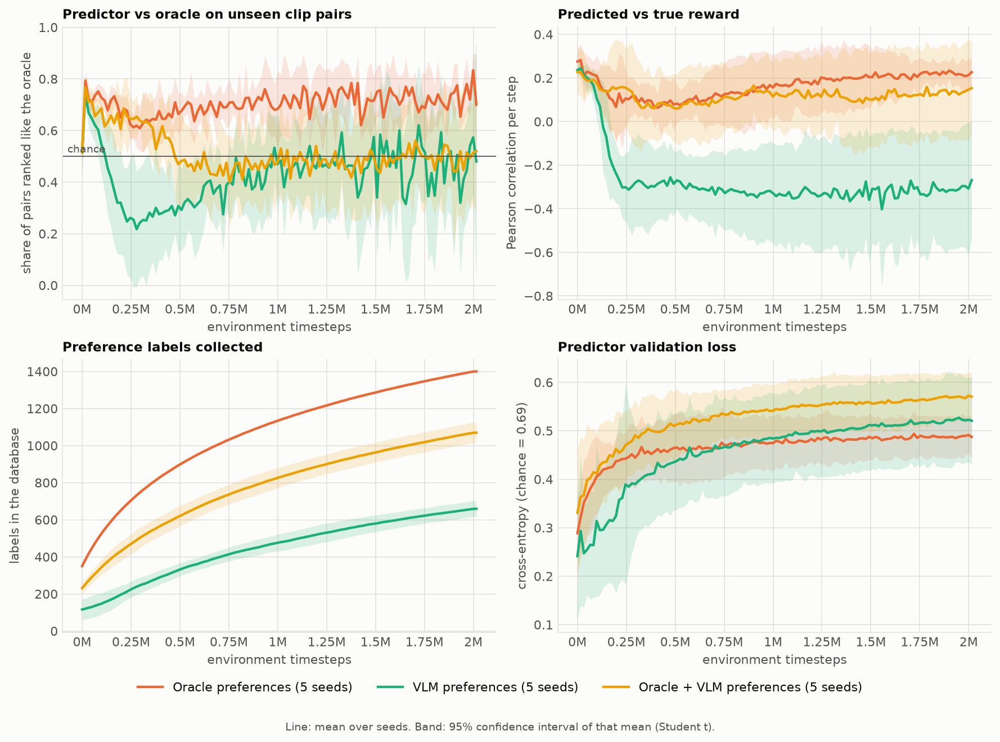
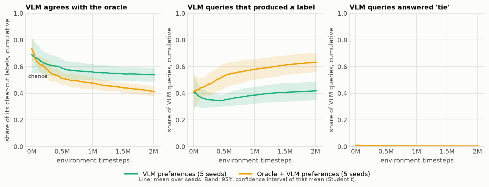

# Results: preference-based RL on LunarLander with a VLM rater

Main run `20261112-prefrl-lunarlander-26ecf3`, 12 November 2026. Four conditions, five seeds each, 2M timesteps per
run, 1,400 preference queries per learned-reward run. Method and configuration are described in the
[README](../README.md).

## Summary

With Qwen2.5-VL-7B as the only rater, the agent did not learn to land: every seed ended with no successful landings,
and four of five learned to fly away from the pad. With the true-reward oracle as rater the method worked but stayed
well below PPO trained directly on the true reward. A 50/50 mix of oracle and VLM labels landed in between the oracle's
range, with the largest spread across seeds. No condition reached the "solved" score of 200 on average.

| condition | final return, mean [95% CI] | per seed | successful landings | labels in the database |
|---|---|---|---|---|
| PPO on true reward | 166 [134, 197] | 176, 202, 159, 153, 137 | 68% | none needed |
| Oracle preferences | 39 [-60, 138] | 135, 40, 94, -66, -8 | 29% | 1,400 of 1,400 |
| VLM preferences | -2,114 [-4,204, -23] | -2,051, -4,779, -1,625, -1,996, -118 | 0% | 659 of 1,400 on average |
| Oracle + VLM, 50/50 | 84 [-91, 259] | -117, 171, -3, 144, 225 | 40% | 1,070 of 1,400 on average |

Final return is the mean over 100 evaluation episodes of the deterministic final policy, scored with the true
environment reward. Intervals are Student-t 95% intervals of the mean over the five seeds. With five seeds they are
wide: the only differences they support are that the VLM-only condition is far worse than the other three, and that
the oracle condition is below the true-reward baseline. Oracle and mixed cannot be told apart.

## Figures

Also in `results/plots/`: `training_return.png` (return of the stochastic policy during training) and `summary.csv`.

## What happened in each condition

**True reward.** Returns rose steadily to 137-202. The policies land in 60-80% of episodes; the rest crash or hover
until the time limit.

**Oracle preferences.** All 1,400 queries were answered. The reward predictor ranked unseen clip pairs like the oracle
63-79% of the time. Policies improved to a best evaluation of 52-182 depending on the seed, and two seeds (3 and 4)
ended below zero. The paper reports oracle labels nearly matching RL; this implementation does not reach that.

**VLM preferences.** Only 47% of queries produced a label (the two clip orders had to give the same answer), and 39%
of those labels were ties. Where the VLM picked a clip it agreed with the oracle 50-59% of the time in four seeds and
72% in the fifth. The four seeds near chance learned to fly up and out of view: in their clips from the last quarter
of training the lander is off-screen for 92-98% of the steps, and final returns are -1,600 to -4,800. Seed 4 never
left the picture; it crashed within about 70 steps in every episode (return -118).

**Oracle + VLM.** Half the queries went to each rater. Three seeds reached 144-225 with 49-80% landings; two did not
learn to land. In four of the five seeds the VLM's labels agreed with the oracle only 29-41% of the time, which is
worse than chance; the next section explains why.

## Why the VLM labels did not help

The VLM is useful on the clips it was calibrated on and on the first, random-policy clips. It stops being useful as
soon as training starts, for two different reasons.

**1. It cannot rank two bad clips, and almost all clips are bad.** In the VLM-only runs 81% of all queries were
pairs in which both clips lose more than 80 reward: two crashes early on, two clips of the lander flying off later.
On those it gave no label for 52%, a tie for 23%, and agreed with the oracle on 53% of the rest.

| VLM-only runs, by phase | queries | got a label | of which ties | agrees with oracle (clear labels) |
|---|---|---|---|---|
| before RL (random policy) | 1,750 | 33% | 0 | 78% of 580 |
| first 0.5M timesteps | 2,715 | 39% | 290 | 52% of 772 |
| after 0.5M timesteps | 2,535 | 65% | 1,011 | 53% of 642 |

**2. It prefers "not crashing", including flying out of view.** When one clip lost more than 80 reward and the other
did not, the VLM agreed with the oracle 79% of the time. But among pairs that differed in how long the lander was off-screen,
it preferred the clip that was off-screen longer in 71% of cases (the oracle: 47%), despite the prompt calling this
as bad as a crash. A reward learned from such labels pays for leaving the picture. Once the lander is gone, both clips
show an empty sky and the VLM answers "tie" (the 1,011 ties above), so nothing corrects the policy.

**3. It rates the situation, while the environment reward rates the change.** This is what makes its labels worse
than chance once policies are competent. LunarLander's reward pays for getting closer, slowing down and straightening
up during the clip; a lander that is already sitting on the ground earns nothing. The VLM prefers the lander that
sits on the ground. In the mixed runs after 0.5M timesteps (984 clear VLM labels):

| the preferred clip is the one that ... | VLM | oracle |
|---|---|---|
| has its legs on the ground for more of the clip | 80% | 26% |
| is closer to the pad on average | 82% | 34% |
| is lower on average | 73% | 27% |
| is slower on average | 78% | 30% |
| gets closer to the pad during the clip | 36% | 74% |
| has the main engine on for more of the clip | 20% | 76% |

(Each row leaves out pairs in which the two clips are equal on that property.)

The prompt asked for exactly the oracle's view ("judge how the situation changes during the clip"), and the
answer-only prompt did not follow it. The VLM's preference is not unreasonable for a person watching; it is simply
not the quantity this experiment scores.

| mixed runs, VLM-answered queries, by phase | queries | got a label | agrees with oracle (clear labels) |
|---|---|---|---|
| before RL (random policy) | 884 | 33% | 76% of 288 |
| first 0.5M timesteps | 1,374 | 43% | 40% of 573 |
| after 0.5M timesteps | 1,255 | 78% | 29% of 984 |

The calibration set did not reveal any of this. Its clips came from landers of very different skill (a scripted
pilot with varying amounts of random actions), where 76% agreement was measured. The clips an agent produces during
training are either all crashes or all competent, and those are the two regimes where the VLM fails.

## Caveats

- Five seeds give wide intervals; see the summary for what they do and do not support.
- The true-reward baseline itself averages 166, below 200. It uses PPO with one hidden layer of 64 units and no
  episode-end signal, which is a harder setting than standard LunarLander benchmarks (see the ablation below).
- The oracle condition underperforms the paper's result. Label budget, label schedule, predictor regularisation and
  PPO settings were not tuned; the adaptive l2 coefficient sat at its ceiling during pretraining.
- The 50/50 mixing ratio is a placeholder; the paper has no such condition.
- One VLM, one prompt, 8 frames per clip. Nothing here says what a larger model, a reasoning prompt or a different
  clip presentation would do.
- "Agreement with the oracle" measures agreement with LunarLander's reward, which rewards progress within a clip.

## Where everything is

- `results/plots/` and `results/calibration/calibration.csv`: in git.
- `results/runs/<condition>/seed_<n>/`: per-run curves (`eval.csv`, `progress.csv`, `rounds.csv`), `summary.json`,
  `queries.jsonl` with every VLM reply, the final policy and reward model, and videos. Not in git (176 MB).
  - `videos/eval/step<timestep>_ep0_return<R>.mp4`: one evaluation episode every 50k timesteps.
  - `videos/eval/final_ep<0-4>_return<R>.mp4`: five episodes of the final policy.
  - `videos/queries/q<id>_vlm-<answer>_oracle-<answer>.mp4` and `..._shown.png`: every 10th VLM query, both clips side
    by side, and the eight frames per clip the VLM was shown.
- The original outputs and logs: `/projects/data/ttsteam/avnish/artifacts/vlm_preference_lunar_lander/runs/20261112-prefrl-lunarlander-26ecf3/`.

## How it was run

One Slurm step (26911.390) inside the 1-GPU allocation on bodhanai-node040, 15:35-17:45 IST (2 h 10 min), exit 0,
all 20 runs complete. Code revision `26ecf31`; figures regenerated with revision `a14a796`. Up to three VLM runs
shared the GPU (22 GB each); the ten runs without a VLM ran on CPU alongside them.
